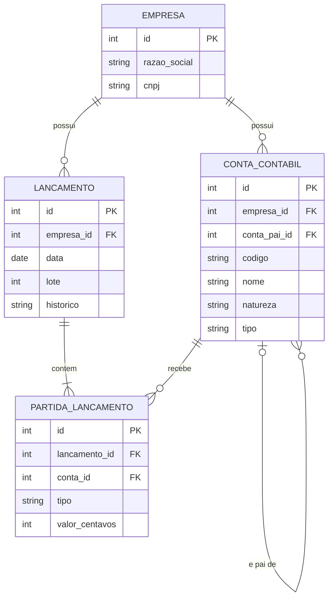

# Modelo de dados

Modelo entidade-relacionamento do módulo de contabilidade (milestone M1). Os valores monetários usam `Decimal`, nunca `float`.

## Diagrama

## Regras

- Toda tabela, exceto `EMPRESA`, tem `empresa_id`, para isolar os dados de cada empresa.
- Lançamentos só podem usar contas **analíticas**. Essa regra fica no domínio, com testes.
- Em cada lançamento, a soma dos débitos deve ser igual à soma dos créditos.
- Um lançamento tem ao menos uma partida de débito e uma de crédito.
- No domínio, valores monetários usam `Decimal`. No banco, são guardados em centavos (inteiro), conforme o [ADR 0002](adr/0002-guardar-valores-em-centavos.md).
- O CNPJ da empresa é único.
- O código da conta é único dentro de cada empresa.
- O lote do lançamento é único dentro de cada empresa.
- O valor da partida (`valor_centavos`) deve ser maior que zero.
- A regra de débitos iguais a créditos é verificada no domínio, e não no banco.
- Fora deste modelo: fechamento de período (M4), importação OFX (M5) e usuários (M8).
