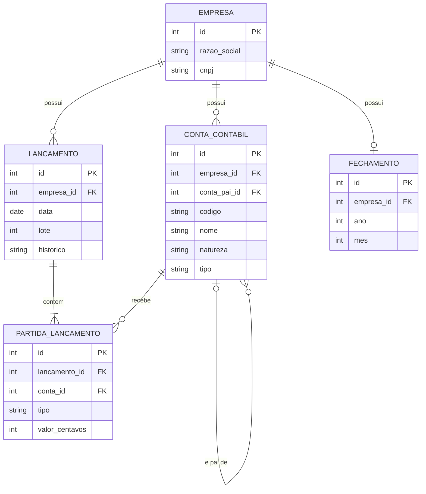

# Modelo de dados

Modelo entidade-relacionamento do módulo de contabilidade (milestone M1 a M4). Os valores monetários usam `Decimal`, nunca `float`.

## Diagrama

## Regras

- Toda tabela, exceto `EMPRESA`, tem `empresa_id`, para isolar os dados de cada empresa.
- Lançamentos só podem usar contas **analíticas**. Essa regra fica no domínio, com testes.
- Em cada lançamento, a soma dos débitos deve ser igual à soma dos créditos.
- Um lançamento tem ao menos uma partida de débito e uma de crédito.
- No domínio, valores monetários usam `Decimal`. No banco, são guardados em centavos (inteiro), conforme o [ADR 0002](adr/0002-guardar-valores-em-centavos.md).
- O CNPJ da empresa é único.
- O código da conta é único dentro de cada empresa.
- O lote do lançamento é único dentro de cada empresa.
- O valor da partida (`valor_centavos`) deve ser maior que zero.
- A regra de débitos iguais a créditos é verificada no domínio, e não no banco.
- O CNPJ deve ter dígitos verificadores corretos (módulo 11, inclusive no formato alfanumérico). A regra é verificada no domínio.
- O código da conta descende do código do pai (`1.1.01.001` sob `1.1.01`). A regra é verificada no domínio.
- O pai de uma conta deve ser sintético. A regra é verificada no repositório, que consulta o tipo do pai.
- A conta de cada partida deve existir na empresa do lançamento e ser analítica. A regra é verificada no repositório, lendo o banco.
- O lançamento é gravado por inteiro ou não é gravado: o repositório verifica todas as regras antes de gravar qualquer linha.
- A competência (ano e mês) é um objeto de domínio ordenável. No banco, o fechamento guarda `ano` (1 a 9999) e `mes` (1 a 12), com restrições de intervalo.
- Cada empresa tem no máximo um registro de fechamento, com a última competência fechada (`empresa_id` único). Sem registro, nenhum período está fechado.
- O primeiro fechamento da empresa pode ser de qualquer competência. Os seguintes só aceitam a competência imediatamente posterior. A regra é verificada no repositório de fechamento.
- Um lançamento com data em competência igual ou anterior à última fechada é recusado, antes de gravar qualquer linha. A regra é verificada no repositório de lançamentos (ADR 0004).
- Fora deste modelo: importação OFX (M5) e usuários (M8).
